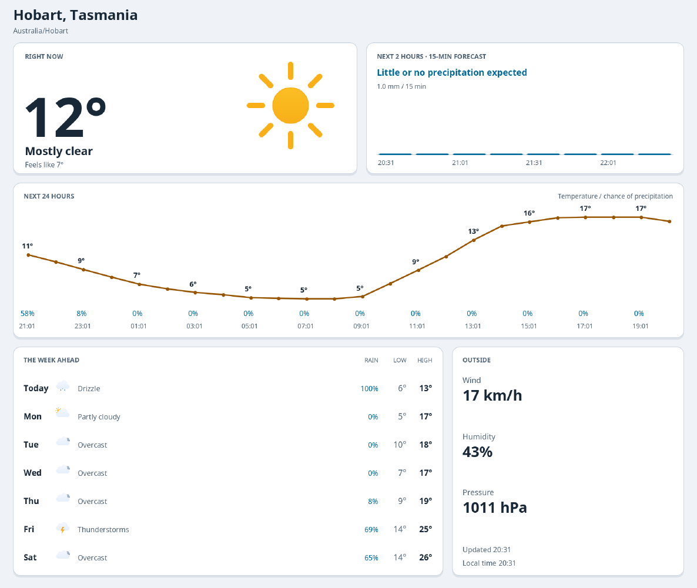
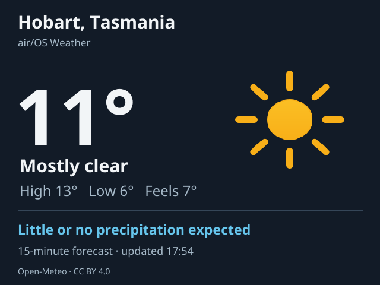

# Weather for air/OS

A native weather app for air/OS and Haiku, with a Dark Sky inspired focus on
what is happening now and what comes next. No account, subscription or API key.



- Current temperature, feels-like temperature, conditions, wind, humidity and pressure.
- Two-hour precipitation chart in 15-minute intervals, 24-hour temperature and
  precipitation-probability chart, and seven-day forecast.
- Permission-based approximate location, city/postal-code search with region
  disambiguation, up to 50 saved locations, and Celsius/Fahrenheit units.
- Responsive cards that stack in narrow windows, with scrolling when needed.
- Light and dark appearance follows Screen preferences and updates immediately.
- A dedicated auxiliary-display layout with large type and only essential data.
- Background HTTPS requests, ten-minute refreshes, saved last forecast, and
  explicit unavailable/offline/stale states. Unknown values are never shown as zero.

## Build and install

On air/OS/Haiku with development tools and private netservices headers:

```sh
make -j4
make check-native
make install
~/config/non-packaged/apps/Weather/Weather
```

Requires `libbe`, `libnetservices`, `libshared`, `libbnetapi`, `libnetwork`,
`libdevice` with `BAuxDisplay`, and `libtranslation`. Install adds Weather to
Deskbar → Applications. The `resources` directory must remain beside the executable.
There is no browser, JavaScript runtime, Python runtime or background server dependency.

Cross-build for ARM64 using the existing air/OS workspace:

```sh
bash tools/build-arm64.sh
bash tools/package.sh arm64 build-arm64
```

Override `WORK`, `CROSS`, `SYSROOT`, `TOOLS`, `HAIKU_TREE`, `HAIKU_BUILD` as needed.
The packaging helper writes a beta `.hpkg` under `artifacts/`. Native x86_64
packaging uses `bash tools/package.sh x86_64 build` on Haiku.

## Locations and privacy

On first launch, Weather asks whether to estimate your location. **Choose city**
declines and opens search. **Allow** contacts [ipapi.co](https://ipapi.co/api/),
which sees your public IP and returns an approximate city. This is not GPS;
VPNs and ISP routing can put the estimate in the wrong city. Coordinates then
go to Open-Meteo for forecasts. No IP-location request occurs before consent.

When following your location, Weather repeats the lookup on startup. Choosing a
saved city stops following. **My location** asks permission again and resumes
following. **Location → Revoke location permission** stops future lookups;
saved cities remain available. Location lookup failure offers city search.

**Locations…** searches cities or postal codes. Select the correct region and
choose **Save and show**. Select a saved location and choose **Show selected**
or double-click it. **Remove** removes the selected saved location.

Settings and the most recent selected forecast are stored in
`~/config/settings/Weather/settings`, written by atomic replacement with owner-only
permissions. If the file cannot be read, Weather preserves it and reports that
changes cannot be saved. `WEATHER_SETTINGS_DIR` supports isolated testing.
Weather has no analytics, advertising or account system.

## Small external displays



**View → Show on auxiliary display** opens the first local `/dev/auxdisplay`
device through air/OS's `BAuxDisplay` Device Kit API, the same interface used by
AirTop. The panel shows location, large temperature and condition, today's range,
feels-like temperature, and one precipitation summary. It does not mirror the
desktop's charts and tables. The 640×480 design scales and centres on the panel.
It redraws when data changes and once per minute, rather than continuously.

Run Weather **on the Raspberry Pi connected to the DSI screen**. A desktop
computer cannot access the Pi's device through its own `BAuxDisplay`:

```sh
Weather --panel
# Explicit coordinates can configure a headless installation without IP lookup:
Weather --panel --location -42.88 147.33 'Hobart, Tasmania'
```

The coordinate example selects Hobart deliberately; it is not an inferred user
location. To use automatic location, open Weather normally on the Pi and grant
permission first. Without a saved location, panel mode opens the desktop setup.
Closing the desktop window keeps an active panel running; Quit stops the app.
Launching Weather again opens its window. With no available panel, the app shows
a status message and falls back to the desktop.

Only one application should own the auxiliary display. Turn off AirTop's panel
or quit its panel-only instance before starting Weather. Installation does not
change login startup or stop another app. Copy `build-arm64/Weather` and its
`resources` directory together to the Pi. [Deployment helper](tools/deploy-pi.sh)
supports an SSH-accessible Pi and leaves starting the panel explicit.

## Data and limits

[Open-Meteo](https://open-meteo.com/en/docs) supplies forecasts; its geocoding API
uses GeoNames. Attribution is included in the About dialog. Weather data
is CC BY 4.0. The free hosted API permits personal/non-commercial use within its
[usage limits](https://open-meteo.com/en/terms). Weather needs no paid key for that
use. Commercial distribution needs a provider arrangement or a different backend.

The precipitation chart is **15-minute model guidance**, sometimes interpolated
from hourly data outside high-resolution coverage. It is not a minute-by-minute
radar nowcast. Weather does not provide radar maps or official severe-weather
alerts. Forecast and search service availability depends on the free providers.

Temperatures are requested in Celsius and wind in km/h, with local unit conversion.
Forecast times use the provider's location UTC offset, not the workstation's zone.
That offset is fixed for each response; a forecast spanning a daylight-saving
transition can have an hour-label discrepancy until the next provider update.

Weather retains the selected forecast after a request fails and labels it saved.
Data becomes stale after 30 minutes without a successful fetch or when the
current observation is over an hour old. Missing precipitation is shown as
unavailable, not as a dry forecast. Settings and city selections never depend
on a successful weather request.

## Validation and licensing

```sh
make check-host                 # portable parser/forecast tests with ASan + UBSan
make check-native               # settings and native bitmap rendering on air/OS
make build/layout_test && build/layout_test --theme # live resize/theme regression
build/native_test --live        # additionally fetch live forecasts and city search
hey Weather get WeatherState   # read-only runtime state for validation
```

See [validation evidence](docs/VALIDATION.md). Native tests use temporary settings;
their sample location and screenshots are illustrative fixtures, not a location claim.

Code is MIT licensed. The JSON parser is adapted from airBrewery (MIT, air/OS
contributors). [Meteocons](https://github.com/basmilius/meteocons) artwork by Bas
Milius is MIT licensed; its license and original SVGs are bundled under
`resources/icons`. PNGs are rasterizations of the upstream artwork, not newly
drawn weather images. Source: `@meteocons/svg-static` version 0.1.0, fill style.

To uninstall, quit Weather and remove its application directory and Deskbar
symlink. Optionally remove `~/config/settings/Weather` to erase saved locations
and permission. No system services or drivers are installed.
